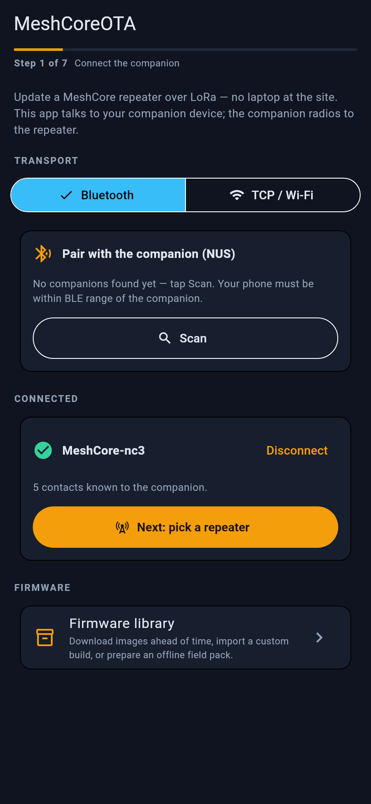
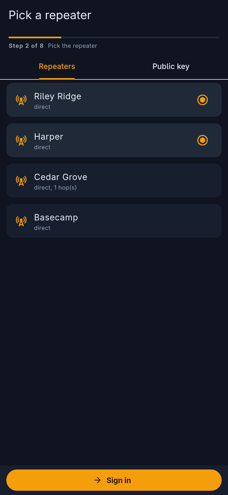
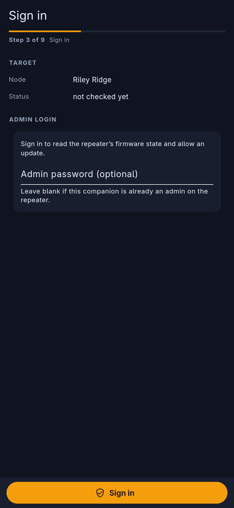
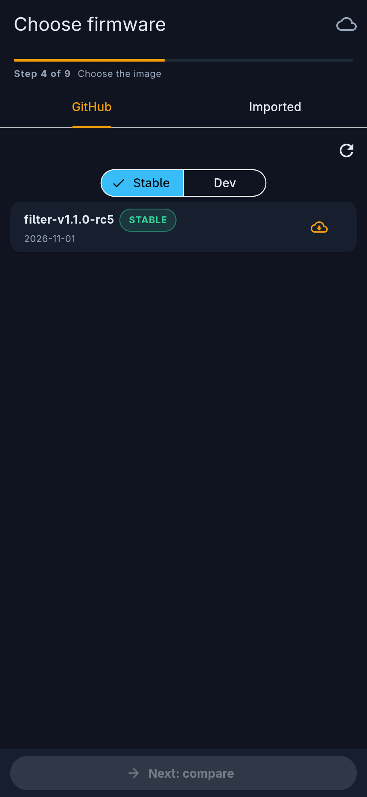
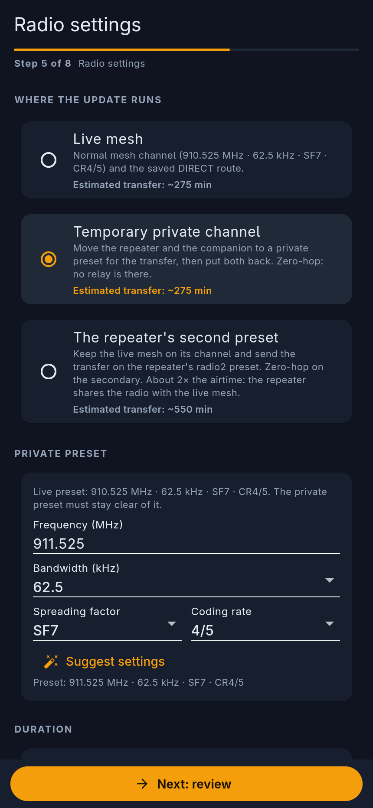
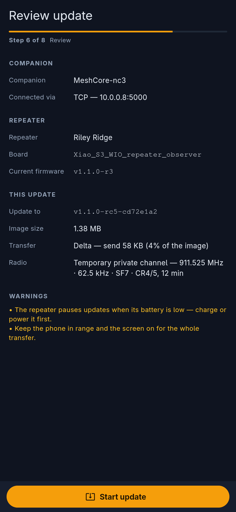
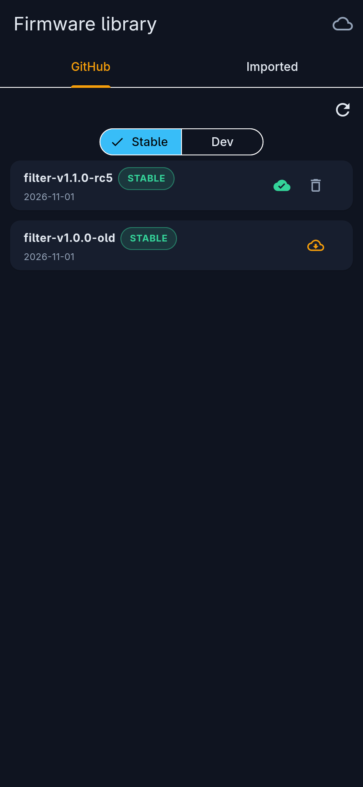
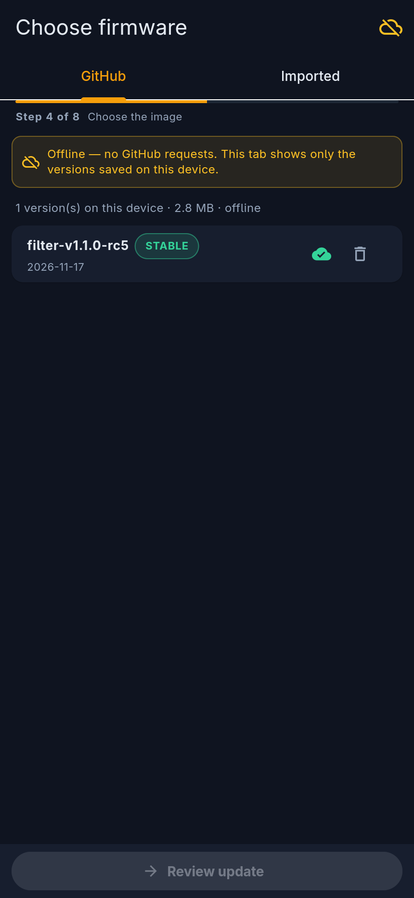

# MeshCoreOTA

<p align="center">
  
</p>

**MeshCoreOTA updates MeshCore repeater firmware over the air, from your phone
or laptop — no tower visit, no laptop at the site, and no special traffic
flooding your mesh.**

A repeater on a hill, a roof or a water tower is hard to reach and easy to
put off updating. Plugging in a USB cable means a climb, a ladder or a drive.
MeshCoreOTA lets an authorised operator send a release to that repeater
through a MeshCore companion that is already on the mesh. The repeater
verifies the image, stores it in its spare firmware slot, and only boots it
when you say so. If the new firmware cannot start its radio, the repeater
flips back to the one that worked, by itself.

The app is a companion for the **[MeshCore](https://github.com/meshcore-dev/MeshCore)
repeater firmware fork**; the over-the-air feature is part of that firmware.
The companion device stays on its stock firmware.

## Download

Releases are on the
**[MeshCoreOTA releases page](https://github.com/jhuebert/MeshCoreOTA/releases)**:

| Platform | What to download | Notes |
|---|---|---|
| Android | `MeshCoreOTA-<version>-universal.apk` | Sideload it; play services are not needed. |
| Linux | `MeshCoreOTA-<version>-linux-x64.tar.gz` | Unpack and run `meshcoreota`. |
| Windows | `MeshCoreOTA-<version>-windows-x64.zip` | Unpack and run `meshcore_ota.exe`. |
| macOS | `MeshCoreOTA-<version>-macos.zip` | Unpack and open `meshcore_ota.app`. |

The desktop builds are unsigned: Windows SmartScreen and macOS Gatekeeper
will ask you to confirm the first launch. Android installs are signed with
the project's app key, so upgrading an existing install keeps your data.

## What you need

- A repeater running the **OTA-enabled MeshCore fork** — see
  [jhuebert/MeshCore](https://github.com/jhuebert/MeshCore). A stock
  repeater says "this firmware does not speak the ota CLI" when you check it.
- A **MeshCore companion** that the app can reach: over Bluetooth on a phone,
  or over Wi-Fi/Ethernet (TCP) on any platform.
- **Admin access to the repeater.** Either the companion's key is already in
  the repeater's admin list (then no password is needed), or you know its
  admin password.
- The firmware image you want to install. The app downloads the fork's
  releases for you, or you can import a `.bin` file — including a custom
  build.

## Getting started

The app walks you through eight steps. You can go back at any point; nothing
is changed on the repeater until the transfer starts, and nothing boots until
you confirm.

### 1. Connect the companion



Pick **Bluetooth** on a phone, or **TCP / Wi-Fi** on a computer (or a phone
talking to a Wi-Fi companion). Tap a discovered companion, or enter its
`host:port`. When the connection succeeds the app moves straight to repeater
selection — there is nothing else to press.

The **Firmware library** is available here before you connect. It is the
same screen as step 4, used for managing your files instead of picking one:
download GitHub release versions, import `.bin` files, or delete images you
no longer need.

### 2. Pick a repeater



The **Repeaters** tab lists the repeaters your companion knows. Use the
**Public key** tab for a node that is not in its contact list — paste the
64-character public key.

### 3. Sign in



The app signs in as repeater admin and reads the node's state: firmware
version, board and boot state. **The password is optional**: leave it blank
when the companion's key already has admin rights in the repeater's access
list. Tapping **Sign in** at the bottom signs you in and moves straight to the
firmware step.

### 4. Choose firmware



The **GitHub** tab lists the fork's releases as **versions** — one row per
version, newest first. **Stable** and **Dev** are separate tabs. The
list only shows versions that have an image for the repeater's board, and the
app picks that image for you — there is no board picker and no per-device
list to manage.

- Tapping a version downloads **its image for your board** (if it is not
  already on the device) and selects it for this update.
- The **cloud button** on a version saves **that whole version** (every
  board's image) on your device for offline use. The cloud icon shows the
  state: outlined cloud = nothing saved, filled cloud = partly saved, cloud
  with a check = saved.
- A saved version shows the done cloud icon on its row, and a trash icon
  deletes the version and all of its images.
- **Imported** shows your imported `.bin` files — one row per file — and is
  where you import a custom build.

### 5. Radio settings



A transfer is heavy for a live mesh, so this step is where you decide where
it runs:

- **Live mesh** — the normal channel and the saved DIRECT route. You can enter
  a DIRECT path override.
- **Temporary private channel** — both the repeater and the companion move to
  a private radio preset for the length of the transfer, then return. The
  transfer is zero-hop, so no other node hears it.
- **The repeater's second preset (radio2)** — the repeater keeps serving the
  live mesh on its normal channel and carries the transfer on its second
  preset. The companion is tuned to it for the duration. If radio2 was
  already enabled, the app tells you and leaves the repeater's configuration
  alone.

The app suggests a private frequency and a duration from the node's radio
settings and the transfer estimate; you can change either.

### 6. Review



The review screen summarizes everything chosen before anything goes on air:
the companion and how it is connected, the repeater and its board, the
firmware it is running now, the firmware you are installing, the image size,
whether this is a delta (only what changed) or the full image and how much
will be sent, a time estimate, and the radio choice. **Start update** begins
the transfer — nothing boots until the final commit.

The delta is computed automatically: the app matches the repeater's reported
image against your library and reuses what it can. If there is no match, it
tells you the full image will be sent.

### 7. Transfer

The app stages the image into the repeater's **inactive** firmware slot,
streams the changes as ordinary encrypted admin requests, and the repeater
asks for anything it missed. Progress and a log are on screen, and once it
is moving the app shows the **estimated time left, based on the measured
rate** (the node is deaf while each op commits to flash, so a transfer takes
much longer than airtime alone would suggest). You can cancel; a cancelled
transfer discards the staged image.

### 8. Commit and verify

When the image is fully staged, it has already passed the repeater's
integrity check. **Commit update** flips the boot partition and reboots.
The app signs back in and confirms the repeater came back on the new image.

If the new firmware cannot start its radio, the repeater's boot health check
flips back to the previous firmware automatically. Once the outcome is known,
you can also roll back manually with **Roll back to previous firmware** — a
rollback is reported as a rollback, never as a verified update. While the
reboot is still being decided the app waits rather than racing it, so the
rollback button is unavailable until then.

## Going offline

The **cloud** button on the firmware screen switches the app offline. In
offline mode it never contacts GitHub — not for the release list, not for an
image. The **GitHub** tab then shows exactly the versions saved on this
device — like a music app's downloaded list. **Imported** is available in
both modes.

The setting is remembered, so a device that goes into the field stays offline
across restarts. Switch it back on when you have a connection.

To prepare: while on Wi-Fi, open **Choose firmware → GitHub**, and tap the
cloud button on the version you want. Every image of that version is saved.
Do the same for the version the repeater currently runs; that second image is
what makes a small delta possible. The **Firmware library** on the main
screen manages what is stored: download versions, delete ones you no longer
need, and see downloaded versions (one row per version) and imported `.bin`
files (one row per file) separately.

## The firmware library

**Firmware library** on the main screen is the same screen as step 4, outside
the update flow. Use the **GitHub** tab to download release versions (tapping
a version downloads all of its missing images), see saved versions in offline
mode (one row per version), and delete a version with the trash icon on its
row. Use the **Imported** tab to import a custom `.bin` (one row per file)
and delete imported files you no longer need. Deleting an image the app had
selected for an update simply clears that selection.

Imported files and downloaded versions are listed separately on purpose:
downloaded images come from releases (they carry the release's board and
version), while an imported `.bin` is identified by its hash alone. When the
repeater reports its running image's SHA-256, the app uses the matching
image — imported or downloaded — as the delta base automatically.

## Custom firmware

Custom builds work exactly like releases:

1. Build your firmware (the repeater side needs the OTA feature).
2. **Firmware library → Imported tab → Import a .bin**, on any platform.
3. Select it on the **Imported** tab (or a saved version on the **GitHub**
   tab, in either mode).

The app works out the before-image automatically: it matches the repeater's
reported image against your library (downloaded releases or imported files).
If nothing matches, it sends the whole image. To force a specific file as
the base, use **Use as delta base** on its row in the **Imported** tab.

A custom image has no board name, so the app uses the board id the repeater
itself reported. The repeater still refuses an image built for another board
and still verifies the hash, so a wrong file cannot be bricked into place.



## Safety and limits

- **Nothing boots until you commit.** Staging writes only the spare slot.
- **The staged bytes are verified by the repeater**, not by the app. A
  mismatch discards the staging session.
- **Only an admin can start.** The same login as every other repeater CLI
  command is required.
- **A bad boot flips back.** The new image must start its radio and send one
  packet; failure restores the previous partition.
- **A low battery suspends staging.** Charge or power the repeater first.
- **Board mismatch is refused.** The image must be built for the board the
  repeater reports.
- The companion is used as shipped. Relays on the path need no custom
  firmware.

## Troubleshooting

| What you see | What it means |
|---|---|
| "This firmware does not speak the ota CLI" | The repeater is not running an OTA-enabled fork build. Flash one over USB/Wi-Fi first. |
| "login rejected" | The password is wrong and this companion's key is not in the repeater's admin list. Try the password, or add the key on the repeater. |
| "logged in, but not as admin" | The key is in the repeater's access list as a guest. Give it admin rights on the repeater. |
| "No saved route" | The companion does not know a path. Enter a direct path on the radio step, use a private radio plan, or let the request flood. |
| "battery gate active; staging refused" | The repeater's battery is low. Charge or power it. |
| "the node refused ... radio2" | radio2 cannot use that preset (it overlaps the live band or cannot be scanned). Pick another frequency. |
| "the image did not pass verification" | The before-image was not matched to the repeater's image (or the file is damaged). Match the image the repeater runs in your library, or let it send the full image. |
| The transfer stalls | A lost reply, not necessarily a lost update. Wait for the retry, or cancel and retry; the staged session is discarded safely. |
| The node does not answer after commit | It may be rolling back. Re-check with the app; if it is back on the old version, the new image failed its boot health check. |

## Screenshots

| Firmware picker | Offline view |
|---|---|
|  |  |

| Radio settings | Review |
|---|---|
|  |  |

| Repeater list | Firmware library |
|---|---|
|  |  |

## How it works (short version)

The app talks to your companion, which encrypts each operation as an ordinary
admin request to the repeater — the same path a status request takes.
Intermediate nodes forward it like any other request, so relays need no
special firmware. The repeater reassembles the stream into its spare firmware
slot, verifies the SHA-256, and waits for an explicit apply. The first boot of
a new image proves its radio; if it cannot, the previous slot boots instead.

The exact wire contract is specified in the fork's
[`OtaUpdate.h`](https://github.com/jhuebert/MeshCore/blob/lora-ota/examples/simple_repeater/OtaUpdate.h)
and summarised in [AGENTS.md](AGENTS.md). The companion stays stock.

## For developers

This repository holds the Flutter app and its pure-Dart packages. Build and
test from the repo root:

```sh
./scripts/check.sh                     # format, analyze, all tests
./scripts/coverage.sh                  # coverage gate
./scripts/build.sh apk --release       # Android
./scripts/build.sh linux --release     # Linux desktop
./scripts/build.sh windows --release   # Windows (run on Windows)
./scripts/build.sh macos --release     # macOS (run on macOS)
```

Two asset helpers keep the guide in sync with the app:

```sh
./scripts/screenshots.sh               # recapture the guide PNGs on a device
./scripts/screenshots.sh --check       # verify every README embed exists
./scripts/icons.sh                     # render icon.svg + all platform icons
./scripts/icons.sh --check             # verify the generated icon targets
```

See [AGENTS.md](AGENTS.md) for the layout, the wire-contract rules and the
verification discipline; [docs/releasing.md](docs/releasing.md) covers signing
and releases; [SECURITY.md](SECURITY.md) has the threat model.
